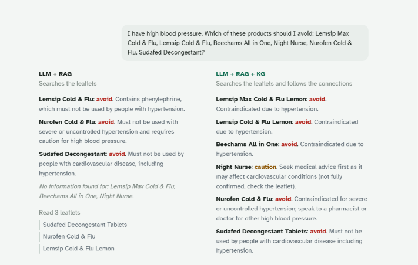
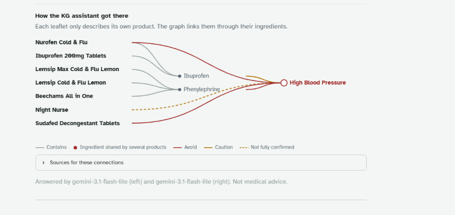
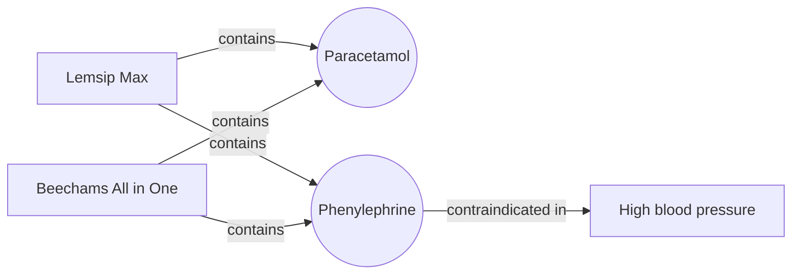

# 💊 Cold and Flu Checker

**Two AI assistants. Same question. Same leaflets. One of them can follow the connections.**

## The problem

Lots of cold and flu remedies share ingredients. It's easy to double up on paracetamol, or take a decongestant with high blood pressure, without realising. Each leaflet only talks about its own product, so the risk hides in the connections between them.

## The idea

Ground Gemini in a knowledge graph of UK cold and flu products, then put it side by side with plain RAG and see what changes.

## The result

**"I have high blood pressure. Which of these should I avoid?"**

| | Products found |
|---|---|
| LLM + RAG | 3 of 6 |
| **LLM + RAG + Knowledge graph** | **6 of 6** |

On simple questions about one product, plain RAG did just as well. The graph earned its place on questions that cut across several products.

## What's inside

* 8 UK products, their ingredients and official warnings from the emc, NHS and MHRA
* Every fact carries its source and a confidence level
* The app draws the exact graph connections behind each answer

**Built with:** Neo4j, Cypher, Python, Gemini and Streamlit

## Run it yourself

1. `pip install -r requirements.txt`
2. Load `graph_setup.cypher` into an empty Neo4j database
3. Add your Gemini and Neo4j keys to `.streamlit/secrets.toml`
4. `streamlit run app.py`

---

Built by [Maureen Okoro](https://www.linkedin.com/in/maureenokoro-analytics), pharmacy graduate and MSc Data Science student, after Chuka Ofili's knowledge graph talk at DevFest Wales 2026.
*Educational demo, not medical advice.*
